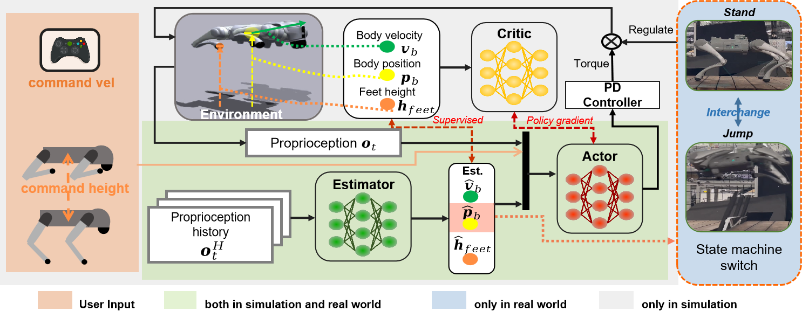
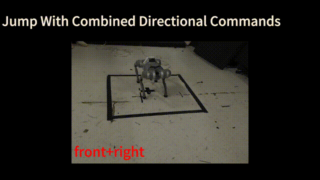
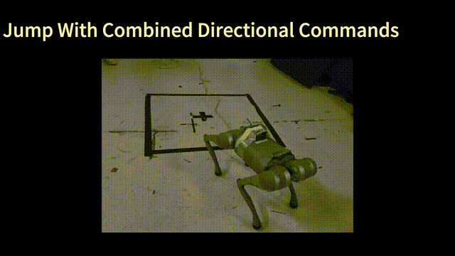
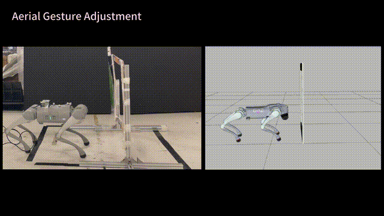
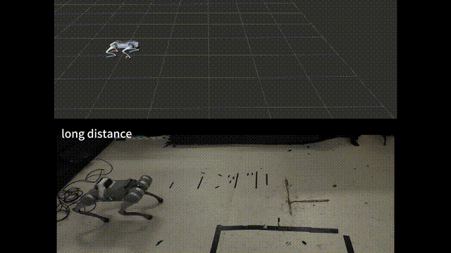

# OmniNet: Omnidirectional Jumping Neural Network With Height-Awareness for Quadrupedal Robots (RAL 2025)

### [Paper📄](https://ieeexplore.ieee.org/document/11045116/) ###

<p align="center">
    <strong>OmniNet: Omnidirectional Jumping Neural Network With Height-Awareness for Quadrupedal Robots</strong><br>
    Yimin Han, Jiahui Zhang, Zeren Luo, Yingzhao Dong, Jinghan Lin, Liu Zhao,<br>
    Shihao Dong, and Peng Lu<br>
    Adaptive Robotic Controls Lab (ArcLab), The University of Hong Kong.
</p>

### Demo ###
🎥 [Video](https://www.youtube.com/watch?v=1Weu46sxc78 )

### Overview ###

In the robotics community, it has been a longstanding
challenge for quadrupeds to achieve highly explosive movements
similar to their biological counterparts. In this work, we introduce a novel training framework that achieves height-aware and
omnidirectional jumping for quadrupedal robots. To facilitate the
precise tracking of the user-specified jumping height, our pipeline
concurrently trains an estimator that infers the robot and its
end-effector states in an online fashion. Besides, a novel reward
is involved by solving the analytical inverse kinematics with pre-
defined end-effector positions. Guided by this term, the robot is
empowered to regulate its gestures during the aerial phase. In the
comparative studies, we verify that this controller can not only
achieve the longest relative forward jump distance, but also exhibit
the most comprehensive jumping capabilities among all the existing
jumping controllers.

### Hardware Experiments ###
#### Multi-directional Jump

<p align="center">
    
    
</p>

#### Frame Traversing
To better demonstrate the robot’s ability to adjust its gesture in the air, we conducted a frame-traversing experiment with the robot. The robot needs to pull its legs close to the trunk in the air, in order to jump through the frame without collision.
<p align="center">
    
</p>

#### Running Jump
To explore the potential of our framework in accommodating different gaits, we combined one trotting policy and jumping policy together. The estimated height is the key for the controller switch in the low-level control loop. The experiments showcase that our framework can empower the robot’s movement to maintain continuity during gait transitions.
<p align="center">
    
</p>

### CODE STRUCTURE ###
1. Each environment is defined by an env file (`legged_robot.py`) and a config file (`legged_robot_config.py`). The config file contains two classes: one containing all the environment parameters (`LeggedRobotCfg`) and one for the training parameters (`LeggedRobotCfgPPO`).
2. Both env and config classes use inheritance.  
3. Each non-zero reward scale specified in `cfg` will add a function with a corresponding name to the list of elements which will be summed to get the total reward.  
4. Tasks must be registered using `task_registry.register(name, EnvClass, EnvConfig, TrainConfig)`. This is done in `legged_gym/envs/__init__.py`, but can also be done from outside of this repository.

### Installation ###

This repository contains the simulation and RL policy code. It uses the standalone NVIDIA Isaac Gym Python API and the algorithm implementations in `rl/` (in particular, `rl/Gen_his/` for omnidirectional jumping).

Use Linux with an NVIDIA GPU and a CUDA-compatible driver. The following setup uses Python 3.8 and PyTorch 1.10 with CUDA 11.3. This is a legacy dependency stack, not a claim of compatibility with current PyTorch or Isaac Lab releases.

1. Create and activate an environment (example using Conda):

   ```bash
   conda create -n omni-jump python=3.8 -y
   conda activate omni-jump
   ```

2. Install [PyTorch 1.10 with CUDA 11.3](https://pytorch.org/get-started/previous-versions/#v1100) and the Python packages imported by the training and playback code:

   ```bash
   python -m pip install torch==1.10.0+cu113 torchvision==0.11.1+cu113 -f https://download.pytorch.org/whl/cu113/torch_stable.html
   python -m pip install numpy==1.23.5 scipy matplotlib tensorboard termcolor trimesh gym==0.23.1
   ```

   NumPy is kept below 1.24 because the environment uses legacy aliases such as `np.int`. `setup.py` does not declare all of these runtime dependencies.

3. Download standalone [Isaac Gym Preview 4 from NVIDIA](https://developer.nvidia.com/isaac-gym), extract it, and install its Python package in the same environment. Replace `/path/to/isaacgym` with the extracted directory:

   ```bash
   python -m pip install -e /path/to/isaacgym/python
   cd /path/to/isaacgym/python/examples
   python 1080_balls_of_solitude.py
   ```

   Use the documentation in `isaacgym/docs/index.html` for simulator setup and troubleshooting.

4. Install the legacy [rsl_rl v1.0.2](https://github.com/leggedrobotics/rsl_rl/tree/v1.0.2) dependency:

   ```bash
   python -m pip install 'rsl-rl @ git+https://github.com/leggedrobotics/rsl_rl.git@v1.0.2'
   ```

   The runners used by this project are bundled in `rl/`, but their recurrent modules still import `rsl_rl.utils.unpad_trajectories`, and `setup.py` requires `rsl-rl`.

5. Clone and install this repository from its root (the directory containing `setup.py`):

   ```bash
   git clone https://github.com/arclab-hku/Omni-Jump.git
   cd Omni-Jump
   python -m pip install -e .
   ```

   If already cloned, run the final command from your existing checkout. Run all commands below from this repository root with the environment activated.

### Usage ###

The entry points are `train.py`, `play.py`, and `play_joy.py` at the repository root. Registered tasks are `go1`, `go2`, `aliengo`, and `arcdog`; always pass `--task`, since the parser's default task is not registered. The examples below use Go2 and the case-sensitive algorithm name `GenHis`.

Task settings are in `legged_gym/envs/<task>/<task>_config_baseline.py`, with shared settings in `legged_gym/envs/base/legged_robot_config.py` and rewards in `legged_gym/envs/base/legged_robot.py`. For Go2, edit `legged_gym/envs/go2/go2_config_baseline.py`. Keep the task, algorithm, and observation/network configuration consistent when loading a checkpoint.

**Current source limitation:** `legged_gym/envs/base/legged_robot.py`, in `_reward_orientation`, contains an extra closing parenthesis in `return torch.sum(torch.square(self.projected_gravity[:, :2]), dim=1))`. It must be corrected to end in `dim=1)` before any training or playback entry point can import the environment. The commands here describe the implemented interfaces; end-to-end simulation has not been validated for this checkout.

#### Train

```bash
python train.py --task=go2 --algo=GenHis --priv_info \
  --num_envs=1800 --headless --seed=1 \
  --output_name=go2/gen_his/omni_jump
```

Choose a new `--output_name` for each fresh experiment; it is the directory used for both saving and loading. Reduce `--num_envs` if GPU memory is limited. Omit `--headless` to open the viewer; press `v` to toggle rendering while training.

For this command, `GenHis` writes:

```text
outputs/go2/gen_his/omni_jump/
├── train_cfg_robot.py       # copy of the robot configuration at training start
├── stage1_nn/
│   ├── model_<iteration>.pt
│   └── last.pt             # updated at periodic save intervals
└── stage1_tb/              # TensorBoard events
```

A numbered checkpoint is also saved when training finishes. `last.pt` is the latest periodic save, which may precede that final checkpoint. No pretrained policy checkpoints are included in this checkout.

```bash
tensorboard --logdir outputs/go2/gen_his/omni_jump/stage1_tb
```

#### Play a trained policy

After training has produced a checkpoint:

```bash
python play.py --task=go2 --algo=GenHis --priv_info \
  --output_name=go2/gen_his/omni_jump \
  --s_flag=1 --checkpoint_model=last.pt
```

This loads `outputs/go2/gen_his/omni_jump/stage1_nn/last.pt`. Replace `last.pt` with an existing `model_<iteration>.pt` to select a particular checkpoint. Playback enables resume internally; it does **not** automatically find the latest run or checkpoint. `play.py` uses up to 10 environments by default and sets fixed command ranges, including a jump height of 0.8; edit those overrides in `play.py` to change the evaluation commands.

#### Resume training

Use an absolute checkpoint path for `GenHis` training: the task registry loads it for resume, and `GenHisPolicyRunner.learn()` also passes `--checkpoint_model` directly to `torch.load()`.

```bash
python train.py --task=go2 --algo=GenHis --priv_info \
  --num_envs=1800 --headless --seed=1 \
  --output_name=go2/gen_his/omni_jump --resume --s_flag=1 \
  --checkpoint_model="$PWD/outputs/go2/gen_his/omni_jump/stage1_nn/last.pt"
```

#### Command-line options

| Option | Behavior in this repository |
| --- | --- |
| `--task` | Registered robot task: `go1`, `go2`, `aliengo`, or `arcdog`. |
| `--algo=GenHis` | Selects `GenHisPolicyRunner` from the bundled `rl/Gen_his/` implementation. |
| `--priv_info` | Enables the encoder's privileged-information setting, as in the supplied GenHis training scripts. |
| `--output_name` | Save/load directory relative to `outputs/`; defaults to `debug`. |
| `--resume` | Loads a checkpoint before training. |
| `--s_flag=1` | Selects `stage1_nn` for loading; `2` selects `stage2_nn`, and `3` selects the directory named by `--resume_name`. Use `1` for GenHis. |
| `--checkpoint_model` | Explicit checkpoint filename for playback, or an absolute path for GenHis training/resume. |
| `--num_envs`, `--seed` | Override the environment count and training seed. |
| `--max_iterations` | Number of learning iterations to run; GenHis adds this to the restored iteration counter. |
| `--headless` | Disables the viewer. |
| `--sim_device`, `--rl_device` | Select simulator and learning devices, e.g. `cuda:0`. |

The inherited `--experiment_name`, `--run_name`, `--load_run`, and `--checkpoint` flags do not select the output directory or checkpoint in this implementation. Use `--output_name`, `--s_flag`, and `--checkpoint_model` instead. Example shell wrappers are in `legged_gym/scripts/`; inspect their task, output name, and hardcoded checkpoint before using them.

#### Optional policy export

Add `--export_policy` to the playback command to export TorchScript `actor.pt` and `encoder.pt` to `outputs/<output_name>/exported_s1/`. For ONNX, install `onnx` in the same environment and add `--export_onnx_policy`; files are written to `outputs/<output_name>/exported_onnx_s1/`.

#### Optional joystick playback (ROS 1)

`play_joy.py` additionally requires a ROS 1 installation with `rospy`, `sensor_msgs`, `std_msgs`, and the `joy` package available to the Python interpreter used above. Source your ROS environment in each terminal. Connect a compatible joystick and run these in separate terminals:

```bash
roscore
```

```bash
rosrun joy joy_node
```

From the repository root, with the Python environment activated:

```bash
python play_joy.py --task=go2 --algo=GenHis --priv_info \
  --output_name=go2/gen_his/omni_jump \
  --s_flag=1 --checkpoint_model=last.pt
```

The script subscribes to `/joy` and maps axes 4, 3, and 0 to forward, lateral, and yaw commands. Adjust `PlayJoy.joy_callback()` for your controller's mapping. ROS is only needed for joystick playback.

### Adding a new environment ###
The base environment `legged_robot` implements a rough terrain locomotion task. The corresponding cfg does not specify a robot asset (URDF/ MJCF) and no reward scales. 

1. Add a new folder to `legged_gym/envs/` with `<your_env>_config_baseline.py`, which inherit from an existing environment cfgs
2. If adding a new robot:
    - Add the corresponding assets to `resources/`.
    - In `cfg` set the asset path, define body names, default_joint_positions and PD gains. Specify the desired `train_cfg` and the name of the environment (python class).
    - Select a unique `--output_name` when launching training
3. (If needed) implement your environment in <your_env>.py, inherit from an existing environment, overwrite the desired functions and/or add your reward functions.
4. Register your env in `legged_gym/envs/__init__.py`.
5. Modify/Tune other parameters in your `cfg`, `cfg_train` as needed. To remove a reward set its scale to zero. Do not modify parameters of other envs!

### Citation ###
If you find this work useful, please cite:

```bibtex
@article{han2025omninet,
    title={Omninet: Omnidirectional jumping neural network with height-awareness for quadrupedal robots},
    author={Han, Yimin and Zhang, Jiahui and Luo, Zeren and Dong, Yingzhao and Lin, Jinghan and Zhao, Liu and Dong, Shihao and Lu, Peng},
    journal={IEEE Robotics and Automation Letters},
    year={2025},
    publisher={IEEE}
}
```
### LICENSE ###
This repositorie is licensed under GPLv3 license. International License and is provided for academic purpose. If you are interested in our project for commercial purposes, please contact [Dr. Peng Lu](https://arclab.hku.hk/People.html) for further communication.